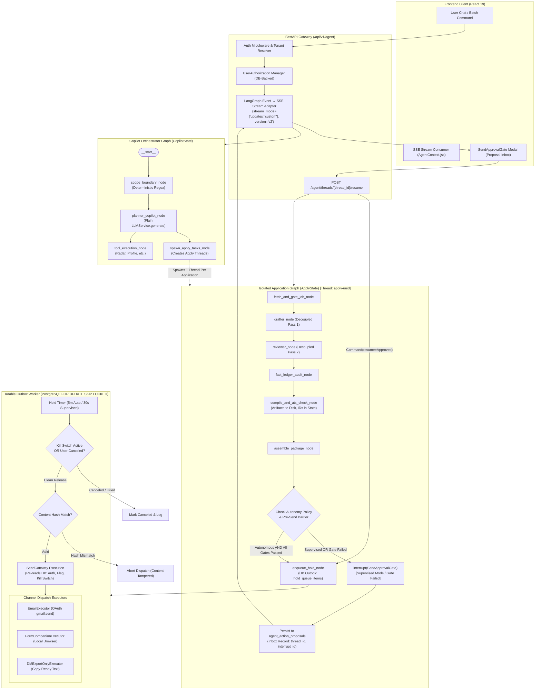

# JobEazy: LangGraph Migration & Per-Account Autonomy Architecture Plan

> **Document Version:** 1.2.2  
> **Date:** 2026-11-10  
> **Author:** Antigravity (Lead Architect)  
> **Status:** Option B Selected by Niloy Sannyal — LangGraph Sections FROZEN (Deferred, not approved)  
> **Target Branches:**  
> • Immediate Milestone M1: `feat/real-dispatch` (cut from current HEAD)  
> • Milestone M0+: `feat/langgraph-orchestration` (cut only upon M1 completion and explicit approval)

---

## 1. Executive Summary & Scope

### 1.1 Decision D1 Resolution & Architectural Intent
This plan defines the architectural migration of JobEazy's agent orchestration from its bespoke procedural engine (`backend/app/services/agent/engine.py`) to **LangGraph** (exact dependencies resolved in M0 lockfile), while operationalizing **Decision D1 (Autonomous Send)**:
- **Default Baseline:** Human-in-the-Loop review before send (`supervised` mode) remains the foundational invariant for every tenant.
- **Sanctioned Exception:** An opt-in, per-account `autonomy_mode` (`supervised` | `autonomous`). In `autonomous` mode, an explicit, authenticated user command targeting specific jobs constitutes real-time authorization to dispatch applications across validated channels.
- **Unified Security Boundary:** Both supervised and autonomous execution paths converge on a single, hardened `SendGateway`. Every dispatch requires a database-backed, single-use authorization record with content-hash pinning, an undo hold queue, an emergency kill switch, Trust-On-First-Use (TOFU) recipient domain validation, and deterministic pre-send verification barriers.

### 1.2 Go / No-Go Verdict: What NOT to Move to LangGraph
- **GO (Orchestrate via LangGraph):**
  - Modular Application Pipeline (`ApplyGraph`): Decoupled Drafter pass, Reviewer pass, Fact Ledger audit, ATS/PDF verification, Package Assembly.
  - Human-in-the-Loop approval workflows utilizing LangGraph `interrupt()` and `Command(resume=...)`.
  - Conversational Career Copilot parent graph (`CopilotGraph`) managing conversational turns, session state, and thread persistence.
- **NO-GO (Keep as Plain Stateless Services / Plain Functions — DO NOT Graph-ify):**
  - **Job Sourcing & Ingestion (`job_ingestion.py`, `job_sources/*`):** High-throughput, stateless data fetching across 6 APIs. A graph adds overhead without value.
  - **Posting Integrity Gate (`posting_guard.py`):** Pure functional regex and Unicode sanitizer. Must execute synchronously before postings reach persistence or LLMs.
  - **Vector Similarity & Language Gate (`matching/*`):** Mathematical array operations and Qdrant queries. Stay plain services invoked as tools.
  - **Low-Level LaTeX Compilation (`texlive_compiler.py`):** Subprocess wrapper executing `pdflatex`/`latexmk`. Remains a stateless utility service called by graph nodes.
  - **Hold Queue & Dispatch Execution:** Graph nodes must NEVER sleep for minutes. The hold queue is managed by an asynchronous background outbox worker.

---

## 2. Current State Map (Codebase Ground Truth)

Every finding below has been verified against raw source code on `feat/agentic-career-copilot`:

| Subsystem | Source Location | Implementation Details & Architectural Reality |
|---|---|---|
| **Agent Engine** | [`backend/app/services/agent/engine.py`](file:///c:/Users/NiloySannyal/Projects/job-agent-saas/backend/app/services/agent/engine.py) | • `AgentEngine` constructor (L69-81) takes `account_id`, `db_session`, `user_email`, `llm_service`.<br>• `chat_stream()` (L117-319) yields SSE frames: `thought`, `tool_start`, `tool_complete`, `proposal_created`, `text_chunk`, `done`.<br>• Intent routing: `_evaluate_scope_boundary()` (L443-487) detects general programming queries; `_detect_fast_track_tool()` (L393-441) bypasses LLM for 6 common prompts.<br>• **CRITICAL FINDING (`approve_proposal()`, L554-607):** Approval only sets proposal status to `"approved"`, `sent_at = now()`, and `status = "applied"` in the DB. **NO email is dispatched; NO web form is submitted.** External dispatch is currently simulated. |
| **Email Services** | [`backend/app/services/email/email_service.py`](file:///c:/Users/NiloySannyal/Projects/job-agent-saas/backend/app/services/email/email_service.py)<br>[`backend/app/services/email_dispatch/dispatch_service.py`](file:///c:/Users/NiloySannyal/Projects/job-agent-saas/backend/app/services/email_dispatch/dispatch_service.py) | • `email_service.py` (L1-112): Purely for sending 6-digit registration OTP verification emails via SMTP.<br>• `dispatch_service.py` (L1-169): Generates `mailto:` links and RFC 822 `.eml` files with `X-Unsent: 1`. In `EmailDraftProvider.GMAIL_API`, it returns a mock dummy draft ID (`gmail_draft_...`, L142). Contains **no actual Gmail API calls**. |
| **Tool Registry** | [`backend/app/services/agent/registry.py`](file:///c:/Users/NiloySannyal/Projects/job-agent-saas/backend/app/services/agent/registry.py)<br>[`backend/app/services/agent/tools/`](file:///c:/Users/NiloySannyal/Projects/job-agent-saas/backend/app/services/agent/tools/) | • 6 registered tools: `search_and_rank_jobs`, `autonomous_tailor_cv`, `stage_application_proposal`, `star_interview_prep`, `track_application_lifecycle`, `reflect_candidate_profile`.<br>• Only `stage_application_proposal` declares `requires_human_approval = True`.<br>• Tools return structured `ToolResult` containing `GenerativeUIWidget` payloads (`JobRadarCarousel`, `TailorDiffReview`, `SendApprovalGate`, `STARStoryMatch`, `FunnelInsight`). |
| **LLM Provider Layer** | [`backend/app/services/llm/base.py`](file:///c:/Users/NiloySannyal/Projects/job-agent-saas/backend/app/services/llm/base.py)<br>[`backend/app/services/llm/service.py`](file:///c:/Users/NiloySannyal/Projects/job-agent-saas/backend/app/services/llm/service.py) | • `LLMProvider.generate(prompt, context) -> str` (L12-28) is text-in/text-out only. Does NOT support native tool-calling, structured outputs, or token streaming.<br>• `LLMService` resolves priority-ordered providers from `llm_providers` table with a bedrock `settings.OPENAI_API_KEY` fallback.<br>• `OpenAIProvider` uses raw `httpx.AsyncClient` directly to `api.openai.com`, avoiding external SDK dependencies. |
| **CV Tailoring Pipeline** | [`backend/app/services/cv_tailor/tailor_service.py`](file:///c:/Users/NiloySannyal/Projects/job-agent-saas/backend/app/services/cv_tailor/tailor_service.py) | • Single monolithic method `tailor_for_job()` (L230-610, 380 lines) runs both Drafter pass (L440-484) and Reviewer pass (L486-510) sequentially with delimiter parsing (`---FINAL_SUMMARY---`, `---FINAL_COVER---`).<br>• **Refactoring Requirement:** Drafter and Reviewer must be decoupled into distinct callables (`draft_cv()` and `review_cv()`) to serve as clean LangGraph nodes.<br>• Fact Ledger (`fact_ledger.py`): 18 verified metric regexes; 5 disallowed patterns.<br>• ATS check (`ats_checker.py`): Contact detail validation and keyword overlap scoring.<br>• PDF compile (`texlive_compiler.py`): Server-side `pdflatex`/`latexmk` with 25-second timeout. |
| **Integrations & OAuth** | [`backend/app/models/oauth.py`](file:///c:/Users/NiloySannyal/Projects/job-agent-saas/backend/app/models/oauth.py)<br>[`backend/app/api/integrations.py`](file:///c:/Users/NiloySannyal/Projects/job-agent-saas/backend/app/api/integrations.py)<br>[`backend/app/services/integrations/google_service.py`](file:///c:/Users/NiloySannyal/Projects/job-agent-saas/backend/app/services/integrations/google_service.py) | • `OAuthConnection` table stores encrypted tokens (`encrypted_access_token`, `encrypted_refresh_token`).<br>• `GoogleIntegrationService` currently requests `https://www.googleapis.com/auth/gmail.compose` (L16) and calls `/gmail/v1/users/me/drafts` (L20).<br>• **Scope Realities:** `gmail.compose` is a **Restricted scope** (mandates annual third-party CASA audit for public SaaS) and already allows sending. `gmail.send` is a **Sensitive scope** (no CASA audit required). To send cleanly without CASA, the app must transition to `gmail.send` and call `/gmail/v1/users/me/messages/send`. |
| **Match Scoring & Precision** | [`backend/app/services/matching/service.py`](file:///c:/Users/NiloySannyal/Projects/job-agent-saas/backend/app/services/matching/service.py) | • `score_and_gate_jobs()` computes cosine similarity between candidate vector and job vector in Qdrant.<br>• Calibrated linearly: `(similarity - 0.25) / (0.75 - 0.25) * 100.0`, clamped to `[15.0, 95.0]`, with +3/+8 role boosts (L208-227).<br>• **CRITICAL FINDING:** **No match-score precision measurement exists in the codebase today.** `ExperienceReflector` only tracks historical skill multipliers, not ground-truth precision/recall. |
| **Persistence Schema** | [`backend/app/models/agent.py`](file:///c:/Users/NiloySannyal/Projects/job-agent-saas/backend/app/models/agent.py) | • Tables: `agent_conversations` (L96), `agent_messages` (L146), `agent_action_proposals` (L14).<br>• All tables enforce tenant isolation with `account_id` foreign keys and indexes. |
| **Frontend SSE Consumer** | [`frontend/src/context/AgentContext.jsx`](file:///c:/Users/NiloySannyal/Projects/job-agent-saas/frontend/src/context/AgentContext.jsx) | • `sendMessage()` (L313-580) reads SSE stream using `ReadableStream` reader.<br>• Processes frames: `thought`, `tool_start`, `tool_complete`, `proposal_created`, `text_chunk`, `done`. |
| **Verification Loop & Migrations** | [`scripts/verify.py`](file:///c:/Users/NiloySannyal/Projects/job-agent-saas/scripts/verify.py)<br>[`scripts/check_migrations.py`](file:///c:/Users/NiloySannyal/Projects/job-agent-saas/scripts/check_migrations.py) | • 5-phase pre-commit gate: Vite build, 210 Pytest tests, DB model tenancy audit, security review, Graphify sync.<br>• `check_models_tenancy()` verifies every model in `app/models/` inheriting `Base` carries `account_id`.<br>• Alembic linear head: `74cebd545352` (12 tracked migrations). |

---

## 3. Decision D1 Resolution Text (for `docs/ARCHITECTURE.md §3`)

```markdown
### 3. Human-in-the-Loop & Autonomy Policy (Amended 2026-11-10 per Decision D1)

**Default: Draft -> Human Review -> Send.**
Human review before send remains the foundational invariant of JobEazy. Every newly created account defaults to `autonomy_mode = "supervised"`. No external communication is ever dispatched without explicit human inspection and approval unless the account has explicitly configured autonomous operations.

#### 3.1 Per-Account Autonomy Modes
Accounts configure operational policy via `account_dispatch_settings`:
1. `supervised` (Default for all accounts):
   The agent executes the Find -> Tailor -> Audit -> Package pipeline and pauses at human approval (`SendApprovalGate`). The candidate inspects the tailored CV, cover letter, and ATS audit score, and explicitly clicks Approve. Approval sets `Application.status = 'queued'`, mints a content-pinned `send_authorizations` record, and enqueues the item in `hold_queue_items` with a 30-second undo window.
2. `autonomous` (Opt-in via explicit authenticated acknowledgment):
   Permits unattended application dispatch across allowed, verified channels for an explicit, authenticated `user_commands` record (`POST /api/v1/dispatch/commands`) targeting a specific job.
   - **Rollout Guard:** Gated behind tenant configuration, enabled initially for the owner account (Niloy) for Phase 1 dogfooding, and disabled for other tenants pending review.
   - **No Background Auto-Apply:** Autonomous execution can NEVER be triggered by a background timer, cron schedule, webhook, or autonomous radar scan. It strictly requires an explicit user command initiated from an authenticated session.
   - **Database-Backed Single-Use Authorization:** Managed via `send_authorizations {id, account_id, command_id, application_id, content_hash, recipient_email, attachment_sha256, minted_by, status, expires_at, consumed_at}`. Both autonomous policy and supervised approvals mint this same single-use record. SendGateway requires a valid, unconsumed, unexpired authorization matching the exact content hash.
   - **Canonical Length-Prefixed Content Pinning:** `content_hash` is computed as `sha256(len:cv_id|len:subject|len:body|len:recipient|len:answers|len:attachment_sha256)`. SendGateway re-verifies this hash against the database and builds the RFC 2822 MIME strictly from pinned bytes. Any edit during the hold window immediately voids authorization.
   - **Pre-Send Verification Barrier:** Autonomous dispatch automatically downgrades to `supervised` if any of the following fail:
     (a) Fact Ledger audit finds unverified claims or disallowed exaggerations.
     (b) ATS check score is below threshold (< 70%) or text layer contains < 100 characters.
     (c) PDF compilation fails, page count != 1, or header invalid.
     (d) Posting integrity gate flagged injection or suspicious content.
     (e) Recipient domain fails Trust-On-First-Use (TOFU) validation.
     (f) Daily cap (default 5, max 10) or hourly cap (default 2) exceeded.
   - **Hold Queue & Undo Window:** Dispatches enter `hold_queue_items`. Supervised approvals enter a 30-second undo window. Autonomous dispatches enter a 5-minute hold window. Users may cancel before release.
   - **Dual Kill Switch:** An account-level toggle (`account_dispatch_settings.kill_switch`) and platform-level global environment variable (`DISPATCH_GLOBAL_KILL_SWITCH`) immediately pause dispatching.
   - **Channels Allowed:** Verified Email (via user's own OAuth with `gmail.send`). Direct Messages (LinkedIn/Twitter DMs) and LinkedIn Easy Apply are permanently excluded from autonomous execution.
```

### Decision Log Entry (for `docs/ROADMAP.md` & `docs/ARCHITECTURE.md`)
| Date | Phase | Decision | Rationale |
|---|---|---|---|
| 2026-11-10 | 1 | **D1: Per-Account Autonomy Policy with Multi-Layer Guardrails** | Allows high-leverage autonomous job applications for owner dogfooding while strictly preserving the human-in-the-loop default for all other tenants. Gated by `user_commands`, DB-backed `send_authorizations`, length-prefixed content pinning, hold queue, send caps, dual kill switches, and TOFU domain validation. DMs permanently excluded. |

---

## 4. Target Architecture: Split Graphs & Topology

> [!WARNING]
> **FROZEN: Deferred, not approved.**
> Decision Option B selected by Niloy Sannyal (2026-11-10): Implementing Milestone M1 (real dispatch) and M1b (autonomy policy on the legacy engine) first on branch `feat/real-dispatch`. The LangGraph orchestration design below is preserved for future architectural evaluation after live Phase 1 dogfooding, but is not currently active for implementation.


### 4.1 System Topology Diagram



---

## 5. State Schemas, Nodes, and Interrupt Catalogs

> [!WARNING]
> **FROZEN: Deferred, not approved.**
> Decision Option B selected by Niloy Sannyal (2026-11-10): Implementing Milestone M1 (real dispatch) and M1b (autonomy policy on the legacy engine) first on branch `feat/real-dispatch`. The LangGraph orchestration design below is preserved for future architectural evaluation after live Phase 1 dogfooding, but is not currently active for implementation.


### 5.1 Decoupled Graph States (`CopilotState` vs `ApplyState`)
To isolate conversational chat turns from heavy application pipelines, state schemas are split:

```python
from typing import Annotated, Any, Dict, List, Literal, Optional
from pydantic import BaseModel, Field
from langgraph.graph.message import add_messages

# --- 1. Copilot Conversation Graph State ---
class CopilotState(BaseModel):
    messages: Annotated[List[Dict[str, Any]], add_messages] = Field(default_factory=list)
    account_id: str
    user_email: str
    active_job_id: Optional[str] = None
    spawned_apply_thread_ids: List[str] = Field(default_factory=list)

# --- 2. Application Pipeline Graph State ---
class ApplicationPackageRef(BaseModel):
    application_id: str
    job_id: str
    company_name: str
    role_title: str
    channel: Literal["email", "form", "dm", "portal"]
    tailored_cv_version_id: str          # FK to account_cv_versions.id
    pdf_artifact_path: str               # Server file path; NO raw bytes in state
    ats_score: float
    fact_audit_passed: bool
    recipient_email: Optional[str]
    email_subject: Optional[str]
    email_body: Optional[str]
    form_answers: Dict[str, str]
    dm_text: Optional[str]
    content_hash: str                    # SHA-256 of tailored text + recipient + answers

class ApplyState(BaseModel):
    account_id: str
    job_id: str
    user_email: str
    autonomy_mode: Literal["supervised", "autonomous"] = "supervised"
    command_id: Optional[str] = None     # Tracing back to user command
    authorization_id: Optional[str] = None
    package_ref: Optional[ApplicationPackageRef] = None
    review_iteration: int = 0            # Bounded: max 1 reviewer revision
    audit_flags: List[str] = Field(default_factory=list)
    downgrade_reason: Optional[str] = None
    status: Literal["idle", "processing", "waiting_approval", "enqueued_hold", "dispatched", "failed"] = "idle"
```

### 5.2 Node Inventory Table & Tailor Refactoring
| Graph Node Name | Backing Service / Module | Implementation Strategy & Refactoring |
|---|---|---|
| `scope_boundary_node` | `_evaluate_scope_boundary` (`engine.py:443`) | Rejects out-of-scope coding/algorithm queries deterministically. Plain function. |
| `planner_copilot_node` | `LLMService.generate()` (`service.py:98`) | Calls `LLMService.generate()` directly. Emits `thought` and `tool_start` via `get_stream_writer()`. |
| `fetch_and_gate_job_node` | `Job` model + `posting_guard.py` | Loads posting and verifies `integrity_status == 'clean'`. |
| `drafter_node` | `CVTailorService` (`tailor_service.py:440`) | **Refactored out of tailor_for_job()**: Executes Pass 1 drafting as an independent callable. |
| `reviewer_node` | `CVTailorService` (`tailor_service.py:486`) | **Refactored out of tailor_for_job()**: Executes Pass 2 critique. Increments `review_iteration`. |
| `fact_ledger_audit_node` | `fact_ledger.py` (`fact_ledger.py:48`) | Deterministic regex audit against verified metrics & disallowed claims. |
| `compile_and_ats_check_node` | `texlive_compiler.py` + `ats_checker.py` | Compiles PDF via server TeX, writes PDF to disk, records `pdf_artifact_path`, extracts text for ATS check. |
| `assemble_package_node` | `ApplicationPackageRef` constructor | Assembles references, saves draft Application record in DB with `sent_at=None`, computes `content_hash`. |
| `autonomy_evaluator_node` | Code policy engine (Section 6) | Evaluates pre-send barrier and TOFU recipient validation. |
| `hitl_approval_node` | LangGraph `interrupt()` | Pauses execution and surfaces `SendApprovalGate` payload. Registers in `agent_action_proposals`. |
| `enqueue_hold_node` | DB Outbox service | Inserts row into `hold_queue_items` with appropriate release delay. |

### 5.3 Bounded Review Loop & Recursion Limit
- **Longest Legitimate Path Measurement:**
  Copilot plan (1) → spawn apply thread (1) → fetch job (1) → drafter (1) → reviewer (1) → revision drafter (1) → fact audit (1) → compile & ATS (1) → package assembly (1) → autonomy check (1) → HITL interrupt/resume (1) → enqueue hold (1) = **12 steps**.
- **Recursion Limit:** Set `recursion_limit = 25` (well above 12, preventing false-positive terminations).
- **Loop Bounding:** `review_iteration` is checked in the conditional edge after `reviewer_node`. If `review_iteration >= 1`, the graph is forced to proceed to `fact_ledger_audit_node`.

---

## 6. Autonomy Policy Engine & Guardrails

> [!NOTE]
> **Superseded by `docs/plans/m1-real-dispatch-spec.md` v1.1.0 §2-§6 for M1/M1b Implementation.**
> Database-backed `send_authorizations`, `user_commands`, length-prefixed content pinning, and TOFU recipient validation are implemented directly on the legacy engine per M1 specification.

### 6.1 Database-Backed Authorization Model & Content Pinning [SUPERSEDED]
*Detailed in `docs/plans/m1-real-dispatch-spec.md` §2 and §4.*
- Replaced `user_authorizations` with `user_commands` (authority to attempt) and `send_authorizations` (content-pinned transmission record).
- Canonical length-prefixed encoding: `sha256(len:cv_id|len:subject|len:body|len:recipient|len:answers|len:attachment_sha256)`.
- Re-reads application state in DB at release time; hash mismatch immediately voids authorization.

### 6.2 Trust-On-First-Use (TOFU) Recipient Validation & Public-Mail Block [SUPERSEDED]
*Detailed in `docs/plans/m1-real-dispatch-spec.md` §6.3.*
- Recipient domain validated against `trusted_recipients` allowlist.
- Corporate domains allowed only if confirmed from ATS job board URLs (`greenhouse.io`, `lever.co`, `ashbyhq.com`) or target company records.
- Public webmail domains (`gmail.com`, `yahoo.com`, `outlook.com`, etc.) strictly require explicit human confirmation for every single application.
- Confirmed exact recruiter addresses are stored with `entry_type = 'exact_address'` and are reusable for that company.

### 6.3 Resilient SendGateway & Idempotency Key
1. **Fresh Database Re-Read:** Re-reads `account_dispatch_settings`, kill switch, daily/hourly caps, and `send_authorizations` directly from DB.
2. **Sequenced Idempotency Key:** Composite unique constraint on `(account_id, job_id, channel, sequence_kind)` in `dispatched_actions`.
3. **Ambiguous Failure Handling:** Network drops or timeouts during `users.messages.send` mark the action status as `"unknown"` (never auto-retried).

---

## 7. Gmail Integration Architecture (Scope Correction)

### 7.1 Scope Classification & CASA Exemption
Per official Google API Documentation (*Google Identity: OAuth 2.0 Scopes for Google APIs*, retrieved 2026-11-10; URL: `https://developers.google.com/gmail/api/auth/scopes` and *Google Cloud OAuth API verification FAQ*, retrieved 2026-11-10; URL: `https://support.google.com/cloud/answer/9110914`):
- `https://www.googleapis.com/auth/gmail.compose`: **Restricted Scope**. Grants full draft management and email creation. Mandates an annual third-party **CASA (Cloud App Security Assessment) tier-2 audit** if user data touches external servers.
- `https://www.googleapis.com/auth/gmail.send`: **Sensitive Scope**. Grants outgoing message transmission only (`users.messages.send`). **Does NOT require a third-party CASA audit**; standard Google App Verification (privacy policy, Terms of Service, walkthrough video) is required for public launch, while test mode and unverified production consent support owner dogfooding.

### 7.2 Integration Strategy
1. **Scope Selection:** Request **`https://www.googleapis.com/auth/gmail.send` exclusively**.
2. **Drafts Inside JobEazy:** Keep CV and outreach drafting inside JobEazy's database and UI (`ApplicationStudio`), completely avoiding `gmail.compose` and CASA audits.
3. **Owner Account Rollout (Phase 1):** Deploy Google Cloud Console in **Production (Unverified)** mode with OAuth consent screen published. Niloy's owner account authorizes directly via standard unverified-app warning screen.
4. **Re-Consent Flow (Milestone M1):** Existing Google OAuth records using `gmail.compose` will display an "Upgrade Connection Permissions" banner in Settings, cleanly directing the user through re-consent to `gmail.send`.
5. **No SMTP for Outreach:** SMTP is reserved strictly for registration OTPs (`email_service.py`).

---

## 8. Persistence, Checkpointers & Hold-Queue Architecture

### 8.1 Hold Queue: PostgreSQL DB Outbox vs Arq/Redis Comparison

| Dimension | Option A: `arq` + Redis Worker | Option B: PostgreSQL DB Outbox (`hold_queue_items`) |
|---|---|---|
| **Dependencies** | Requires running Redis server + separate Arq worker process. | Zero new services; uses existing PostgreSQL database. |
| **Durability** | In-memory with Redis snapshotting. Requires configuring Append-Only File (AOF) to survive crashes without dropping queued sends. | 100% ACID durable in Postgres. Survives server restarts or container redeployments effortlessly. |
| **Transaction Safety** | Cannot enroll Redis enqueue into the database transaction creating the application. | Enqueue row commits in the exact same transaction as `Application` and `UserAuthorization`. |
| **Maintenance** | `arq` is a light, community-maintained library (v0.28.0 installed). | Native SQL pattern using `SELECT ... FOR UPDATE SKIP LOCKED`. |
| **Recommendation** | Acceptable if Redis is already mission-critical. | **RECOMMENDED:** Eliminates distributed state bugs and AOF overhead; matches single-VPS MVP architecture perfectly. |

**Recommended Design (PostgreSQL DB Outbox):**
- Table `hold_queue_items {id, account_id, application_id, authorization_id, release_at, status}`.
- Background poller running every 5 seconds queries:
  ```sql
  SELECT * FROM hold_queue_items
  WHERE status = 'pending' AND release_at <= NOW()
  ORDER BY release_at ASC
  FOR UPDATE SKIP LOCKED
  LIMIT 10;
  ```
- **Hold Duration:** 5 minutes for autonomous dispatches; 30-60 seconds (configurable) for supervised dispatches to provide an instant "Undo" button in the UI.

> [!WARNING]
> **FROZEN: Deferred, not approved.**
> Decision Option B selected by Niloy Sannyal (2026-11-10): Implementing Milestone M1 (real dispatch) and M1b (autonomy policy on the legacy engine) first on branch `feat/real-dispatch`. The LangGraph orchestration design below is preserved for future architectural evaluation after live Phase 1 dogfooding, but is not currently active for implementation.

### 8.2 Supabase Connection Pooler Setup
Per Psycopg 3 Connection Pool Documentation (*Psycopg 3.3 Connection Pools*, retrieved 2026-11-10; URL: `https://www.psycopg.org/psycopg3/docs/advanced/pool.html`):
In Psycopg 3, `prepare_threshold=None` completely turns off prepared statements (whereas `prepare_threshold=0` prepares on the very first execution, causing prepared statement collisions on Supabase's transaction pooler on port 6543):

```python
from psycopg_pool import AsyncConnectionPool
from psycopg.rows import dict_row
from langgraph.checkpoint.postgres.aio import AsyncPostgresSaver

pool = AsyncConnectionPool(
    conninfo=settings.DATABASE_URL,
    min_size=2,
    max_size=15,
    check=AsyncConnectionPool.check_connection,  # Verifies connection health before handoff
    kwargs={
        "autocommit": True,         # Required: setup() runs CREATE INDEX CONCURRENTLY
        "row_factory": dict_row,    # Required by LangGraph checkpointer
        "prepare_threshold": None,  # Disables prepared statements completely in psycopg3
    },
    open=False,
)

checkpointer = AsyncPostgresSaver(pool)
checkpointer.supports_pipeline = False       # Prevents Supavisor transaction multiplexing errors
```
- **Milestone M0 Verification Requirement:** M0 must explicitly prove this pool configuration against the real Supabase pooler on port 6543.
- **Why `autocommit=True` is Mandatory:** LangGraph's `checkpointer.setup()` executes `CREATE INDEX CONCURRENTLY`. In PostgreSQL, concurrent index creation **cannot run inside a multi-statement transaction block**; it throws a fatal error unless autocommit is active.

### 8.3 Checkpoint Encryption & Lifecycle Retention
Per LangGraph Checkpoint Persistence Documentation (*LangGraph Checkpoint Encryption Serde*, retrieved 2026-11-10; URL: `https://github.com/langchain-ai/langgraph/blob/main/libs/checkpoint/langgraph/checkpoint/serde/encrypted.py`):
```python
from langgraph.checkpoint.serde.encrypted import EncryptedSerializer

# Uses dedicated 32-byte encryption key (CHECKPOINT_ENCRYPTION_KEY), NOT APP_SECRET_KEY
encrypted_serde = EncryptedSerializer.from_pycryptodome_aes(
    key=settings.CHECKPOINT_ENCRYPTION_KEY_BYTES
)
checkpointer = AsyncPostgresSaver(pool, serde=encrypted_serde)
```
- **Retention & Stale Thread Expiry:**
  - Completed threads pruned after 30 days.
  - Paused threads waiting for human review expire after **7 days**. Expired threads are marked `status = "expired"` in `agent_action_proposals`, and the UI displays an "Expired Approval Window" notice, requiring the candidate to re-trigger tailoring.

### 8.4 Multi-Tenant Boundary: Checkpoint Tables vs `thread_accounts`
- **Tenancy Reality:** LangGraph's internal tables (`checkpoints`, `checkpoint_blobs`, `checkpoint_writes`) are created by `checkpointer.setup()` and **do not carry an `account_id` column**.
- **Tenancy Audit (`check_migrations.py`):** The audit script scans only SQLAlchemy models inheriting `Base` in `backend/app/models/`. It does not fail on LangGraph's raw tables.
- **Authorization Enforcement:** To enforce strict multi-tenant isolation, the `thread_accounts` table (`thread_id`, `account_id`, `graph_type`) is verified by FastAPI middleware before every resume:
  ```sql
  SELECT 1 FROM thread_accounts WHERE thread_id = :thread_id AND account_id = :account_id;
  ```
  If ownership cannot be established, the request is rejected with `403 Forbidden` before LangGraph checkpointer is accessed.

---

## 9. Redesigned SSE Protocol Adapter & UI Integration

> [!WARNING]
> **FROZEN: Deferred, not approved.**
> Decision Option B selected by Niloy Sannyal (2026-11-10): Implementing Milestone M1 (real dispatch) and M1b (autonomy policy on the legacy engine) first on branch `feat/real-dispatch`. The LangGraph orchestration design below is preserved for future architectural evaluation after live Phase 1 dogfooding, but is not currently active for implementation.


### 9.1 Custom Streaming Loop (Part Objects in Version "v2")
Per LangGraph v2 Streaming Documentation (*LangGraph astream version v2 Protocol*, retrieved 2026-11-10; URL: `https://langchain-ai.github.io/langgraph/how-tos/streaming/`):
In `version="v2"`, `graph.astream()` yields dictionary part objects with keys `{"type", "ns", "data"}`:

```python
# Adapter Loop in FastAPI /agent/chat
async for part in graph.astream(
    input_data,
    config=config,
    stream_mode=["updates", "custom"],
    version="v2"
):
    chunk_type = part["type"]
    payload = part["data"]
    
    if chunk_type == "custom":
        # Payload emitted directly by writer({...}) inside nodes
        yield f"data: {json.dumps(payload)}\n\n"
        
    elif chunk_type == "updates":
        # Check for LangGraph interrupt
        if "__interrupt__" in payload:
            interrupt_val = payload["__interrupt__"][0].value
            # Map __interrupt__ to legacy proposal_created frame
            yield f"data: {json.dumps({
                'type': 'proposal_created',
                'proposal_id': interrupt_val['proposal_id'],
                'ui_widget': interrupt_val['widget']
            })}\n\n"
```

### 9.2 Resume Endpoint & Minimal Frontend Contract
- **Existing Frontend Endpoint:** `POST /api/v1/agent/proposals/{proposal_id}/approve`
- **Adapting Under the Hood (Zero Breaking Changes to UI):**
  Instead of rewriting the frontend to call `POST /agent/threads/{thread_id}/resume`, the existing `/proposals/{id}/approve` endpoint is preserved as a facade:
  1. Frontend clicks Approve on `SendApprovalGate`. Calls `/proposals/{id}/approve`.
  2. The endpoint looks up `agent_action_proposals` by `id` + `account_id`.
  3. Extracts `thread_id` and `interrupt_id`.
  4. Resumes the LangGraph thread via:
     ```python
     await apply_graph.ainvoke(Command(resume={"action": "approve"}), config={"configurable": {"thread_id": thread_id}})
     ```
  5. The graph executes `enqueue_hold_node` and returns success.
**Outcome:** The React frontend continues to work with **zero changes to its API calls or UI components**.

---

## 10. Observability & Cost Controls

> [!NOTE]
> **Superseded by `docs/plans/m1-real-dispatch-spec.md` v1.1.0 for M1/M1b dispatch.**
> Outbound rate limiting and caps are enforced in M1 via `account_dispatch_settings` (daily cap default 5, hourly cap default 2). Token usage accounting in LLMService tracks prompt/completion tokens.

1. **LangSmith Configuration:**
   - **LangSmith is disabled (`LANGSMITH_TRACING=false`)** by default to prevent candidate CV PII (names, contact details, work history) from transmitting to external servers.
   - Tracing uses local structured JSON logging with correlation IDs (`trace_id`, `account_id`, `thread_id`).
2. **Cost Controls & Rate Limiting:**
   - **Per-Account Dispatch Rate Caps:** Enforced via `account_dispatch_settings.daily_cap` (default 5, max 10) and `hourly_cap` (default 2).
   - **LLM Token Tracking:** Every call through `LLMService.generate()` records prompt and completion token counts in application execution logs.

---

## 11. Test Plan & Verification Gate Integration

### 11.1 Test Suite Specifications (`backend/tests/agent/`)

> [!NOTE]
> **Superseded by `docs/plans/m1-real-dispatch-spec.md` v1.1.0 §9 for M1/M1b dispatch testing.**
> Real dispatch test suites run under `backend/tests/dispatch/` and require PostgreSQL dialect. The tests below specify future unit coverage if LangGraph orchestration is resumed.

1. **Checkpointer & Interrupt Unit Tests:**
   - Execute graph runs using `InMemorySaver` checkpointer.
   - Test interrupt suspension and resumption via `Command(resume={"action": "approve"})`.
   - Verify that resuming does NOT re-execute prior node side effects (idempotency).
2. **Tenant Boundary Tests:**
   - Attempt to resume thread belonging to Account A using JWT from Account B. Assert `403 Forbidden`.
3. **Authorization & Content-Hash Tests:**
   - Content hash mismatch: verify `SendGateway` rejects when application body or PDF has changed during hold window.
   - Consumed authorization re-use: assert rejection.
4. **Adversarial Postings & TOFU Spoof Tests:**
   - Posting with prompt injection: assert `PostingIntegrityGate` flags and execution downgrades to supervised.
   - Recipient with public mail domain (`hr@gmail.com`): assert TOFU gate downgrades to supervised.
   - Untrusted corporate domain: assert TOFU gate downgrades to supervised.
5. **Hold Queue & Kill Switch Tests:**
   - Enqueue application; trigger kill switch; verify outbox worker drains queue without sending.
   - Duplicate send test: verify composite unique constraint on `(account_id, job_id, channel, sequence_kind)` blocks duplicate dispatches.
6. **SSE Protocol Contract Test:**
   - Test `LangGraphSSEAdapter` against mock graph stream; assert `data: {"type": ...}` JSON frame format.

### 11.2 Verification Loop Integration (`scripts/verify.py`)
- **Phase 3 (Database Audit):** `thread_accounts`, `user_authorizations`, and `hold_queue_items` models inherit `Base` and carry `account_id`, satisfying `check_models_tenancy()`.
- **Phase 4 (Code Review):** Enforces 800-line ceiling on all new graph modules (`copilot_graph.py`, `apply_graph.py`).

---

## 12. Dependency Plan & Environment Strategy

### 12.1 Lockfile Strategy in Milestone M0
Exact dependencies will be resolved in **Milestone M0** against the active virtual environment and exported to a lockfile (`backend/requirements-langgraph.lock`).

### 12.2 Known Baseline Constraints (Retrieved 2026-11-10)
- `langgraph`: Resolved in M0 lockfile [UNVERIFIED].
- `langchain-core`: Resolved in M0 lockfile [UNVERIFIED].
- `langgraph-checkpoint-postgres`: Resolved in M0 lockfile [UNVERIFIED].
- `psycopg[binary]`: Prebuilt binary wheels active across 3.3.x on PyPI (*PyPI: psycopg-binary*, retrieved 2026-11-10; URL: `https://pypi.org/project/psycopg-binary/#history`).
- `pydantic`: Pydantic 2.14.1 currently installed in venv.
- `pycryptodome`: Resolved in M0 lockfile [UNVERIFIED].

---

## 13. Strategic Options Analysis & Recommendation

### Option A: The Full LangGraph Migration Plan (M1 → M0 → M2-M6)
- **Path:** Build real outbound dispatch on `feat/real-dispatch` (M1), then spike LangGraph (M0), port checkpointers (M2), apply pipeline (M3), copilot (M4), and autonomy (M5).
- **Pros:** Full LangGraph state durability, standard multi-agent tooling, built-in graph visualizer.
- **Cons:** High architectural surface area; requires porting working procedural code to graph semantics.

### Option B: Real Dispatch (M1) + Legacy Engine Autonomy Policy + Delayed Port Decision
- **Path:** Build M1 (real dispatch with `SendGateway`, `gmail.send`, and DB outbox hold queue) on `feat/real-dispatch`. Apply the Decision D1 autonomy policy directly to the existing `AgentEngine` procedural flow. Run Niloy's live job search for 2 weeks. Make a formal Go/No-Go decision on LangGraph based on real dogfooding data.
- **Pros:** Delivers real, supervised (and autonomous owner) job applications immediately with zero graph overhead. Solves Niloy's primary business goal today.
- **Cons:** Delays LangGraph adoption until Phase 1 validation.

### Lead Architect Recommendation
**Adopt Option B (Pragmatic Execution):**
1. Implement **Milestone M1 immediately on `feat/real-dispatch`**. This gives Niloy real outbound email applications and an undo hold queue today.
2. Wire the D1 autonomy policy into the existing engine.
3. Validate Niloy's live job search for 14 days. If agent branching complexity or state recovery proves difficult, execute the LangGraph migration with proven dispatch infrastructure already in place.

---

## 14. Milestone Roadmap & Effort Estimates

| Milestone | Scope & Deliverables | Target Branch | Estimated Effort |
|---|---|---|---|
| **M1: Real Outbound Dispatch** | `user_commands`, `send_authorizations`, `hold_queue_items` DB outbox, `GoogleIntegrationService` (`gmail.send`), `SendGateway`, legacy `approve_proposal` wiring. | `feat/real-dispatch` | **6-8 days** |
| **M1b: Autonomy on Legacy Engine** | Pre-send verification barrier, TOFU domain validation, single-job command endpoint, kill switch on legacy engine. | `feat/real-dispatch` | **4-5 days** |
| **M0: LangGraph & Pooler Spike [FROZEN]** | Spike Supabase pooler on port 6543 (`autocommit=True`, `prepare_threshold=None`), Python 3.14 vs 3.12, lockfile generation. | `feat/langgraph-orchestration` | **3 days (Deferred)** |
| **M2: Checkpointer & Tenancy** | `thread_accounts` table, `checkpointer.setup()`, `EncryptedSerializer`. | `feat/langgraph-orchestration` | **3 days** |
| **M3: Apply Subgraph & Refactoring** | Decouple `tailor_for_job()` into Drafter/Reviewer callables, bounded review loop, `interrupt(SendApprovalGate)`. | `feat/langgraph-orchestration` | **5 days** |
| **M4: Copilot Graph & SSE Adapter** | `CopilotGraph`, `get_stream_writer()` v2 adapter, strangler feature flag. | `feat/langgraph-orchestration` | **4 days** |
| **M5a: Autonomous Email (Owner)** | Pre-send verification barrier, TOFU domain validation, feature flag enable. | `feat/langgraph-orchestration` | **4 days** |
| **M5b: Autonomous Batches & Precision Gate** | Multi-thread batch spawning, `job_feedback` precision gate (>= 80% fit on 50 jobs). | `feat/langgraph-orchestration` | **5 days** |
| **M5c: Autonomous Forms (Local Companion)** | Local Playwright companion (prefill-only), ATS ToS documentation. | `feat/langgraph-orchestration` | **5 days** |
| **M6: Deprecation & Final Verification** | Decommission `engine.py`, full 5-phase verification loop green. | `feat/langgraph-orchestration` | **3 days** |

---

## 15. Decision Register

| Decision ID | Topic | Current Recommendation | Status | Owner Action Required |
|---|---|---|---|---|
| **D1** | **Autonomy Policy** | Supervised default; opt-in autonomous mode for owner account gated by DB authorization and pre-send barrier. | **RESOLVED** | Confirmed directly by Niloy Sannyal (2026-11-10). |
| **D3** | **Observability** | Keep LangSmith **OFF** by default to protect candidate CV PII. Use local OpenTelemetry / structured JSON logs. | **PROPOSED** | Not yet confirmed by Niloy. |
| **D4** | **Python Version** | Evaluate Python 3.14.4 vs 3.12 LTS during M0 spike. Pin one identical minor version for both dev and prod VPS. | **PROPOSED** | Not yet confirmed by Niloy. |
| **D5** | **Checkpointer Tables** | Checkpoint tables managed via `checkpointer.setup()`; tenant isolation enforced via separate `thread_accounts` table. | **PROPOSED** | Not yet confirmed by Niloy. |
| **D6** | **Copilot Architecture** | Decoupled `CopilotState` and `ApplyState`. Reject deep/unbounded agent loops to maintain strict deterministic boundaries. | **PROPOSED** | Not yet confirmed by Niloy. |
| **D7** | **Legacy Engine Continuity** | Build real dispatch first (M1 on `feat/real-dispatch`); run legacy engine during evaluation (Option B). | **PROPOSED** | Option B recommended by advisor and lead architect; awaiting Niloy's direct confirmation. |

---

## 16. Document Changelog
| Version | Date | Author | Description of Changes |
|---|---|---|---|
| **1.0.0** | 2026-11-10 | Antigravity | Initial migration plan authored. |
| **1.1.0** | 2026-11-10 | Antigravity | Advisor Review 1: Checkpointer pool fix, Gmail scope correction, custom SSE streaming, isolated batch threads, hold queue, DB auth, TOFU domain gate. |
| **1.2.0** | 2026-11-10 | Antigravity | **Advisor Review 2 Overhaul:**<br>• Removed hand-typed pins; added verified PyPI/doc citations.<br>• Fixed checkpointer pool: `prepare_threshold=None`, `supports_pipeline=False`, autocommit for `CREATE INDEX CONCURRENTLY`.<br>• Corrected `EncryptedSerializer.from_pycryptodome_aes` signature using dedicated key.<br>• Rewrote SSE adapter using v2 dictionary part objects `{'type', 'ns', 'data'}`.<br>• Added DB Outbox recommendation over Redis for hold queue.<br>• Added Content Pinning SHA-256 hash in `UserAuthorization`.<br>• Prohibited public-mail domains in TOFU allowlist.<br>• Decoupled `CopilotState` and `ApplyState`.<br>• Formulated Options A vs B and re-estimated M1 on `feat/real-dispatch`. |
| **1.2.1** | 2026-11-10 | Antigravity | **Option B Selection & LangGraph Freeze:**<br>• LangGraph sections (§4, §5, §8.2-8.4, §9, M0, M2-M6) frozen as deferred.<br>• Reset D3, D5, D6, D7 to PROPOSED.<br>• Stripped 'verified' from unverified package pins.<br>• Added M1b to roadmap table. |
| **1.2.2** | 2026-11-10 | Antigravity | **Option B Alignment with M1 Spec v1.1.0:**<br>• Rewrote §3 amendment text to match M1 spec: `user_commands`, `send_authorizations`, length-prefixed content pinning, dual kill switches, and rate caps.<br>• Marked §6.1, §6.2, §10, and §11.1 as superseded by `m1-real-dispatch-spec.md` v1.1.0.<br>• Removed disposable-email-domains citation, $0.24/$5/GPT-6 Luna claims, forged-token and >15-min tests.<br>• Corrected §7.1 scope verification citations against official Google OAuth documentation.<br>• Reconciled Decision D7 status across header and register as PROPOSED pending Niloy's direct confirmation.<br>• Documented M1b roadmap entry and lockfile dependency resolution. |
